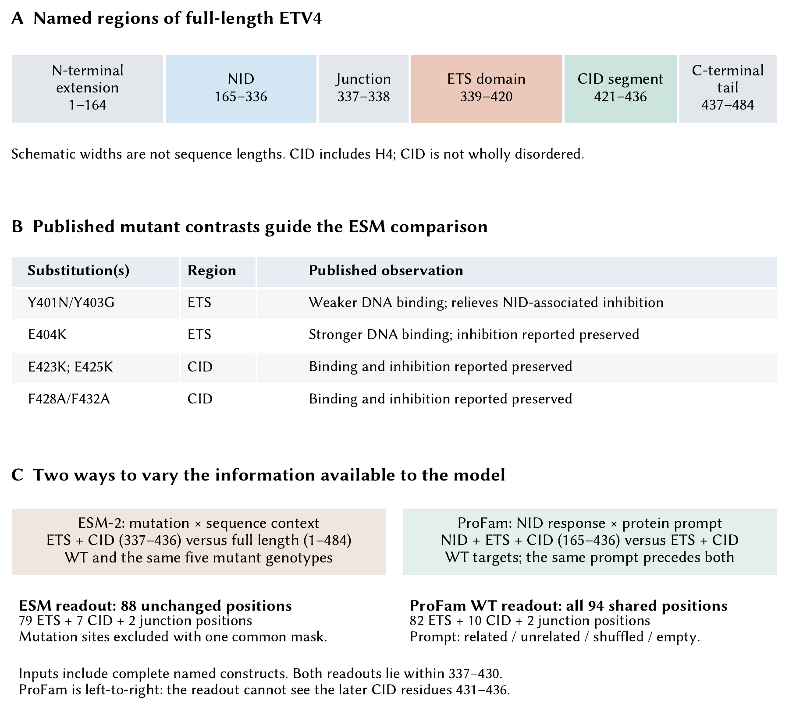
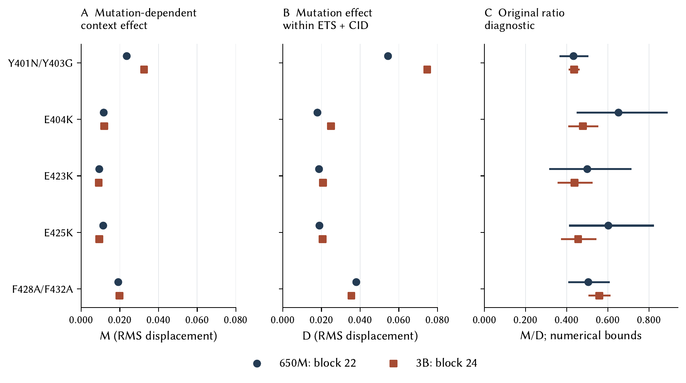
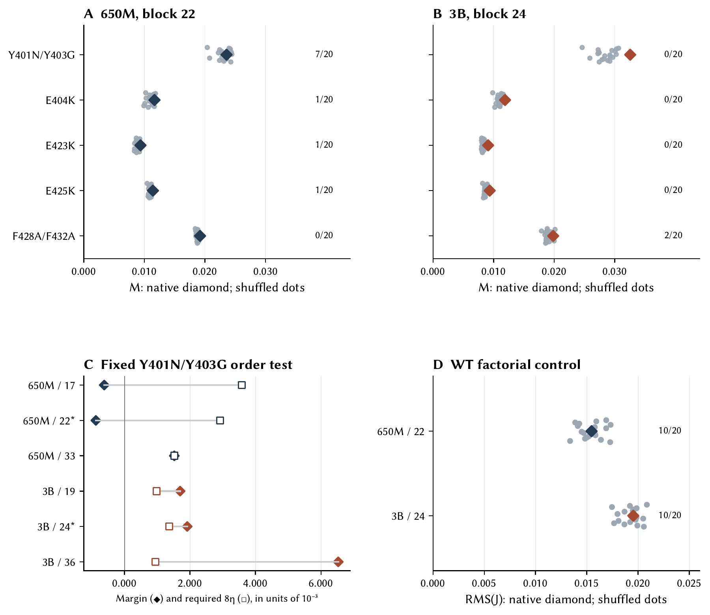
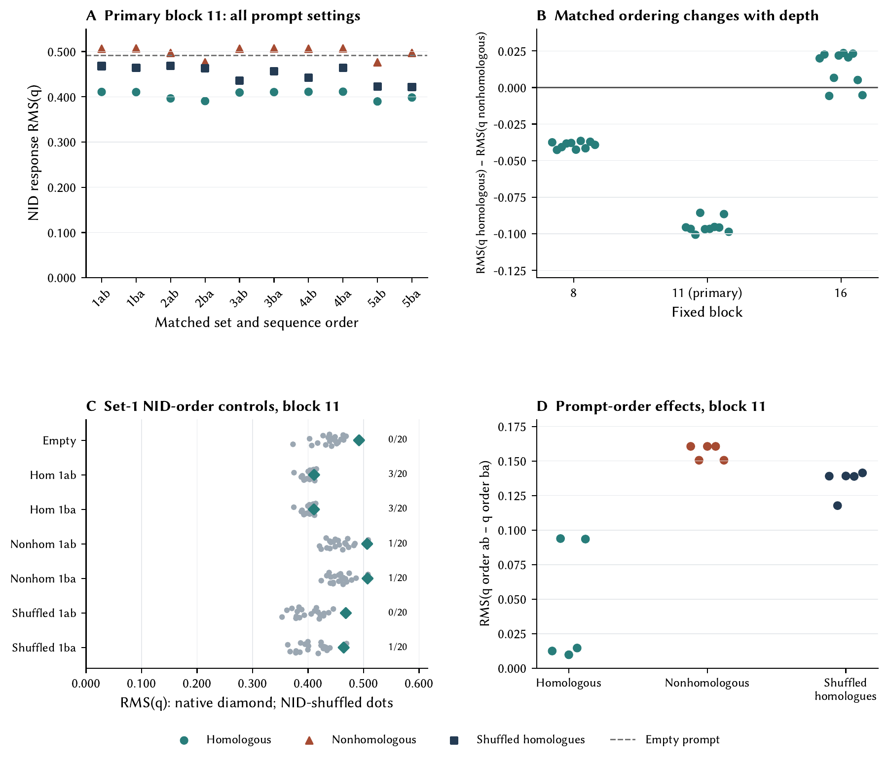

# Sequence and family context shape ETV4 representations in protein language models

**An exploratory computational study of how a DNA-binding domain responds to changes in its sequence surroundings and in the protein-family information supplied to a model.**

This repository accompanies the manuscript by Aurelio Moya García. It provides a self-contained account of the biological question, computational comparisons, results and limitations, followed by the code, data and instructions needed to inspect or reproduce the analyses.

**Main finding.** Context changes the representation response to a defined perturbation. In ESM-2, the response to the same mutation differs between a short ETV4 construct and the full-length protein. In ProFam, the response to adding an inhibitory region depends on which protein sequences precede the target. These effects also depend on model depth and on how the response is measured. Their correspondence to biological regulation remains unresolved.

The supporting code and data are already archived in [Zenodo, DOI 10.5281/zenodo.24220637](https://doi.org/10.5281/zenodo.24220637).

## Reading guide

- [Biological question and experimental reference](#biological-question-and-experimental-reference)
- [What we compared and measured](#what-we-compared-and-measured)
- [Results: mutation responses](#1-mutation-responses-change-with-sequence-context)
- [Results: sequence-order controls](#2-native-sequence-order-matters-in-the-3b-comparison)
- [Results: family prompting](#3-family-prompts-change-the-nid-response-and-the-direction-depends-on-depth)
- [What this pilot contributes](#what-this-pilot-contributes)
- [Reproduction and repository contents](#reproduce-the-figures-and-tables)
- [Citation and reuse](#citation-and-reuse)

For detailed methods and all supplemental tables, read the [supplementary information](docs/etv4-supplement.pdf). Numerical values are available in the [eleven result tables](data/), with column definitions in the [data dictionary](DATA-DICTIONARY.md). The four figures appear below; each also links to its original PDF.

## Biological question and experimental reference

A folded domain operates within a larger protein. Its surrounding sequence can change its biological activity, and a protein language model can likewise assign different internal representations to the same domain in different contexts. We ask a more specific question: **does context change how the model responds to a defined sequence perturbation?** This lets us examine whether the measured response distinguishes changes with different published biological effects.

Our focal protein is human ETV4, an ETS-family transcription factor. Its folded ETS domain binds DNA. Published experiments by [Currie et al. (2017)](https://doi.org/10.1093/nar/gkx068) describe inhibition involving a predominantly disordered N-terminal inhibitory region (NID) and a C-terminal inhibitory segment (CID) that includes a structured helix. CID should therefore not be equated with a wholly disordered tail.

We use native ETV4 coordinates from UniProt P43268, sequence version 3:

| Region | Residues |
|---|---|
| N-terminal extension | 1–164 |
| N-terminal inhibitory region, NID | 165–336 |
| Junction preceding ETS | 337–338 |
| Folded ETS domain | 339–420 |
| C-terminal inhibitory segment, CID | 421–436 |
| C-terminal tail | 437–484 |

The computational panel contains **seven wild-type constructs and five mutant genotypes in each of two contexts: 17 distinct native sequences**. “ETS + CID” refers to residues 337–436, including the junction; it is not an isolated ETS domain. Full-length ETV4 comprises residues 1–484.

The published wild-type dissociation constants illustrate the biological contrast: ETS + CID binds with a reported *K*D of 0.120 ± 0.020 nM, NID + ETS + CID with 0.600 ± 0.100 nM, and full-length ETV4 with 0.830 ± 0.080 nM (means ± reported SEM; lower values indicate tighter binding). These are reused experiments, not model predictions. [All seven affinities and reported replicate counts](data/published-WT-affinities.tsv) are retained.

The mutant panel separates source-reported changes in binding from changes in inhibition:

| Genotype | Region | Published observation used to guide the comparison |
|---|---|---|
| Y401N/Y403G | ETS | Weaker binding in ETS + CID; reduced inhibition in the full-length versus ETS + CID comparison |
| E404K | ETS | Stronger binding in both contexts; inhibition reported as preserved |
| E423K, E425K, F428A/F432A | CID | Binding and inhibition reported as preserved |

These mutant observations are categorical. Some preserved-binding statements were reported without displayed affinity data; we did not infer missing mutant affinities or establish quantitative equivalence. The [source audit](repro/inputs/sources/source-audit.md) identifies the original tables, figures and qualifications. No new binding experiments were performed.

[](figures/fig1-design.pdf)

*Figure 1. The biological reference and computational design. Both models receive complete constructs, while measurements use explicitly defined shared positions. [Open the PDF](figures/fig1-design.pdf).*

## What we compared and measured

A protein language model represents each residue by a vector that changes as information passes through the network. Here, a “representation response” is a difference between these vectors under a defined input change. It is not a measured change in DNA binding. We examined frozen models without training or fine-tuning them on the ETV4 measurements.

| Comparison | What changes | What is compared | Question |
|---|---|---|---|
| **ESM-2 650M and 3B** | The same mutation is introduced in ETS + CID and in full-length ETV4 | Mutant-minus-wild-type representation changes on the same 88 unchanged positions | How does the surrounding sequence alter the mutation response? |
| **ProFam-1** | NID is added to an ETS + CID target under a fixed protein-sequence prompt; this comparison is repeated across prompts | The NID-addition response on 94 shared positions | How does preceding protein-family information alter the response to NID? |

The ESM comparison changes both the N-terminal extension + NID and the C-terminal tail. It does not isolate the NID contribution. The ProFam comparison uses wild-type targets and a different readout; it is a complementary experiment, not a replication of the ESM mutant test.

We measured the residual output of complete transformer blocks, before final model-wide normalization. A block combines attention and feed-forward operations. The primary blocks were **22 for ESM-2 650M, 24 for ESM-2 3B, and 11 for ProFam**. Additional fixed blocks were 17/33, 19/36 and 8/16, respectively. Blocks were chosen by relative depth before each run, not by their regulatory performance. We did not analyse individual attention heads or intervene on internal features.

At each position, vectors were normalized to unit length. Response magnitudes are the root mean square (RMS) of the per-position Euclidean differences. They are dimensionless. The models differ in architecture, representation width, depth and execution backend, so their numerical scales are not a common measure of biological accuracy.

<details>
<summary><strong>Measurement definitions and numerical controls</strong></summary>

For an ESM mutant genotype *g*, let `u_g` be the mutant-minus-WT vector difference in ETS + CID, and `v_g` the corresponding difference in full-length ETV4. Then:

```text
D_g = RMS(u_g)              mutation response within ETS + CID
M_g = RMS(v_g − u_g)        change in that mutation response across contexts
R_g = M_g / D_g             descriptive ratio used in the original criterion
```

`M` is the magnitude of a difference between response vectors, not the difference between their magnitudes. `D` is not a binding energy or a validated direct-binding component. Dividing by `D` has not been shown to isolate regulation.

The ESM readout is positions 337–430 excluding 401, 403, 404, 423, 425 and 428: **88 unchanged positions shared by every genotype**. F432 remains in the input but is outside this window. ProFam uses all **94 positions in 337–430**, including the junction, ETS and part of CID.

Artificial-input qualification established a block-specific numerical discrepancy allowance, `eta`, before biological inference. The original ESM rule required resolved denominators, separation of Y401N/Y403G from the other mutants in `M`, separation of its `M/D` bounds, and separation from its shuffled-prefix controls. For `D > 4 eta`, the ratio bounds are:

```text
L = max(0, M − 8 eta) / (D + 4 eta)
U = (M + 8 eta) / (D − 4 eta)
```

These are numerical sensitivity bounds under the measured implementation discrepancy. They are not biological confidence intervals or a guarantee that every numerical error is bounded. All fixed blocks and failed criteria are retained in the results.

For a fixed ProFam prompt `P`, `q_P` is the normalized representation of NID + ETS + CID minus that of ETS + CID. We report `RMS(q_P)`, matched differences of these magnitudes, and vector differences after prompt-order reversal. A difference of magnitudes and the magnitude of a vector difference answer different questions.

The [supplement](docs/etv4-supplement.pdf), [frozen protocol](repro/inputs/design/protocol-v1.md), [run plan](historical-execution/original/design/run-plan.json) and [portable analysis code](repro/analyse_activations.py) provide the complete definitions.

</details>

## Results

### 1. Mutation responses change with sequence context

Y401N/Y403G, the double mutant associated with altered inhibition in the experimental reference, produced the largest `M` and `D` at both primary ESM blocks. This means it produced both the largest response within ETS + CID and the largest change in that response between the two sequence contexts.

However, the relative ordering changed when `M` was divided by `D`. At the primary 3B block, F428A/F432A had a smaller absolute response but a larger ratio:

| Genotype at ESM-2 3B block 24 | Context-dependent response, M | ETS + CID mutation response, D | M/D | Numerical bounds for M/D |
|---|---:|---:|---:|---:|
| Y401N/Y403G | 0.033 | 0.075 | 0.436 | 0.414–0.458 |
| F428A/F432A | 0.020 | 0.035 | 0.559 | 0.511–0.609 |

Values are rounded for display; ratios were calculated from full-precision values. The same ratio ordering, with separated numerical bounds, held at the other two 3B blocks. **The original ratio condition failed at every tested block in both ESM model sizes.** The primary Y401N/Y403G ratios were similar in 650M and 3B (0.433 and 0.436), although their components differed.

Thus, a strong absolute response did not establish the proposed regulatory interpretation of `M/D`. Y401N/Y403G also changes DNA binding and has the largest `D`; the present analysis cannot separate those contributions by normalization alone. The failed criterion constrains this readout, rather than demonstrating a general absence of regulatory information in PLMs.

[](figures/fig2-mutation-responses.pdf)

*Figure 2. The mutation ranking depends on the measured quantity. Bounds concern numerical sensitivity, not biological sampling uncertainty. [PDF](figures/fig2-mutation-responses.pdf) · [Primary-block values](data/esm-primary.tsv) · [All fixed blocks](data/esm-all-fixed-blocks.tsv).*

### 2. Native sequence order matters in the 3B comparison

To test whether the context response depended on sequence order, we compared the native N-terminal prefix with **20 shuffled versions of residues 1–336**. Shuffling preserved length, amino-acid composition and endpoints. Each shuffled prefix was shared between the wild type and its mutants, while the remaining genotype-specific sequence stayed intact.

For Y401N/Y403G, native `M` exceeded every sampled shuffled value by more than the fixed numerical allowance at all three tested 3B blocks. At block 24, the margin was **1.916 × 10⁻³**, against a required **1.365 × 10⁻³**. None of the three 650M blocks passed this condition; at primary block 22, seven of twenty shuffled values were at or above the native response.

This sensitivity to native order was not unique to the experimentally distinctive mutant. E404K, E423K and E425K also exceeded every sampled shuffle descriptively at the primary 3B block. Moreover, a separate wild-type factorial contrast—comparing addition of NID, completion of shortened CID, and both together—lay within its shuffled-control range at both primary ESM blocks: ten of twenty controls were at or above native in each case. That contrast measures non-additivity of model representations, not biological cooperativity or an interaction free energy.

These controls show which responses depend on the native arrangement of residues. They do not by themselves identify a regulatory signal. Shuffle counts are descriptive, not *p*-values; the small CID-completion control includes duplicate draws and one native-order draw, all retained.

[](figures/fig3-order-controls.pdf)

*Figure 3. Native-order sensitivity in the 3B mutant comparison coexists with a failed ratio criterion and an unexceptional primary wild-type factorial response. [PDF](figures/fig3-order-controls.pdf) · [Margins](data/esm-native-order-margins.tsv) · [Mutation shuffles](data/esm-primary-shuffles.tsv) · [WT factorial controls](data/esm-wt-factorial.tsv).*

### 3. Family prompts change the NID response, and the direction depends on depth

ProFam accepts protein sequences before the target as a prompt. We used five pairs drawn from reviewed ETV1/ETV5 proteins, each in both orders, together with exactly length-matched nonhomologous prompts, composition-shuffled homologous prompts and an empty prompt: **31 settings**. For each setting, we measured the representation change caused by adding NID to ETS + CID.

At primary block 11, the response magnitude was **0.492 without a prompt**. Homologous prompts gave smaller responses than the matched nonhomologous prompts:

| Prompt category at ProFam block 11 | NID-addition response, RMS(q) |
|---|---:|
| Empty | 0.492 |
| Homologous proteins | 0.390–0.411 |
| Matched nonhomologous proteins | 0.476–0.507 |
| Composition-shuffled homologous proteins | 0.422–0.469 |

This ordering depended on depth. Homologous prompts gave smaller responses in all ten matched comparisons at blocks 8 and 11, but **larger responses in eight of ten at block 16**. Reversing the two prompt proteins also changed the response vectors. The reversal concerns representation magnitudes; it is not a reversal of biological inhibition, and neither direction has been established as more accurate regulatory encoding.

Twenty NID-shuffled target controls were evaluated under the empty prompt and the six set-1 settings. At block 11, three of twenty shuffled responses equalled or exceeded native under each homologous order, compared with zero under the empty prompt and one under each nonhomologous order. Native-order separation was therefore not uniform across settings. Prompted NID-shuffle controls cover set 1 only.

Two design limits are essential to this interpretation. First, ProFam reads from left to right: ETS positions cannot see downstream CID, and the shared readout cannot see residues 431–436. This experiment cannot establish CID-to-ETS regulation; the zero ProFam factorial contrast is an architectural check. Second, prompts overlap: the ten named nonhomologous settings contain only four distinct ordered prompts. They are not independent biological replicates, and matching does not isolate homology from every compositional or taxonomic difference. Adding NID also shifts absolute target positions; the NID-shuffled controls preserve that shift.

[](figures/fig4-profam-conditioning.pdf)

*Figure 4. Family information changes the response to the same target perturbation. Depth and prompt order affect the result. [PDF](figures/fig4-profam-conditioning.pdf) · [All prompt responses](data/profam-prompt-responses.tsv) · [Matched differences](data/profam-matched-norm-differences.tsv) · [NID shuffles](data/profam-NID-shuffles.tsv) · [Prompt-order contrasts](data/profam-order-contrasts.tsv).*

## What this pilot contributes

The study provides a worked example of investigating a folded domain within its regulatory surroundings. Published experiments define a biological distinction; paired computational comparisons measure how context changes the response to a perturbation; sequence-order and prompt controls test alternative explanations. The resulting observations identify dependencies that an interpretation of PLM representations must account for: mutation identity, surrounding sequence order, family prompts, prompt order and model depth.

For further research into domain–IDR regulation, this pilot supplies an implemented comparison design, an experimentally grounded ETV4 input panel and reproducible analyses. It also identifies a specific unresolved question: which internal features carry these context effects, and whether those features distinguish documented regulatory changes from other sequence effects. Answering that question would require further feature analysis and controlled interventions within the model, followed by assessment against biological evidence. Those are subsequent research questions, not results of this repository.

The present evidence concerns one focal protein. It does not establish an allosteric mechanism, predict DNA-binding affinity, validate a universal regulatory score, or demonstrate transfer to unseen protein families. ESM-2 3B was a follow-up motivated by the 650M results, not an independent confirmatory study or an isolated test of parameter count. Residues, blocks, prompts and shuffle draws do not supply biological replication. Within these limits, the study establishes context-dependent model responses and shows how the choice of measurement affects their interpretation.

## Reproduce the figures and tables

No GPU or model checkpoint is needed for this step. Use Python 3.11 and Libertinus fonts (available with TeX Live):

```sh
git clone https://github.com/amoyag/etv4-context-representations.git
cd etv4-context-representations
python3 -m venv .venv
.venv/bin/python -m pip install -r requirements-reproduction.txt
.venv/bin/python repro/prepare_figures.py
.venv/bin/python verify_reproduction.py
```

The generator reads seven frozen inputs under `repro/inputs/` and writes four figures and eleven tables under `repro/figures/` and `repro/data/`. It does not run protein models. Set `LIBERTINUS_FONT_DIR` if the Libertinus Sans OTF directory cannot be found automatically. Verification checks exact table equality, source hashes, numerical bounds and descriptive control counts. Reviewed figure PDFs are in `figures/`; regenerated PDF metadata and font rendering can vary across environments.

This reproduces the presentation and checks the saved numerical results. A portable CPU-only activation-analysis command is also available (below). Historical model-inference code is retained for inspection; a portable end-to-end inference runner is not provided. See [the reproducibility guide](REPRODUCIBILITY.md) for external assets, workspace dependencies and the distinction between these levels of reproduction.

## Recompute results from saved activations

The portable analysis uses NumPy and the recorded arrays; it does not load a protein model. Download the three activation ZIP files from [Zenodo](https://doi.org/10.5281/zenodo.24220637) and extract them into one directory so it contains `650m/`, `profam/` and `3b/`, then run:

```sh
.venv/bin/python repro/analyse_activations.py --arrays /path/to/activations --output /path/to/new-analysis
```

The command verifies all 711 array checksums and their agreement with the fixed input plans/configurations. It recalculates both canonical analysis summaries and compares every saved field, including profiles, control results and classification labels. This was verified locally against **107,102 numerical values**. Small float64 comparison tolerances are software-verification tolerances; the scientific metrics and numerical floors are unchanged. See [the verification record](provenance/activation-reanalysis-verification.json).

## Data and repository contents

| Location | Contents |
|---|---|
| [data/](data/) | Eleven full-precision result tables |
| [repro/](repro/) | Figure/table generation and frozen summary inputs |
| [historical-execution/original/](historical-execution/original/) | ESM-2 650M and ProFam adapters, analysis, scientific inputs, configuration and checks |
| [historical-execution/3b/](historical-execution/3b/) | ESM-2 3B adapters, analysis, scientific inputs, configuration and checks |
| [historical-execution/3b-analysis/](historical-execution/3b-analysis/) | Cross-model comparison code |
| [provenance/](provenance/) | Source hashes, activation manifests, verification and release records |
| [supplement/](supplement/), [docs/](docs/), [figures/](figures/) | Supplemental LaTeX, review PDF and figures |

The 711 biological/control activation files are saved model representations: 217 ESM-2 650M outputs, 277 ProFam outputs and 217 ESM-2 3B outputs. Their identities and checksums are recorded in [the activation manifests](provenance/activation-manifests/). Their NPZ payloads and 71 numerical-qualification arrays are openly available in [Zenodo](https://doi.org/10.5281/zenodo.24220637). Model weights are not redistributed.

Scientific controls and numerical qualification records are retained. Machine-setup smoke tests and unrelated workflow utilities are excluded from the current tree. No new model inference was performed to prepare this repository.

## Supplementary information

The [PDF](docs/etv4-supplement.pdf) is a convenient reading copy; the final supplement should also accompany the preprint. Its [LaTeX source](supplement/main.tex) is synchronized from the author-edited Overleaf project. Compile it with:

```sh
cd supplement
sh compile.sh
```

The resulting PDF is `supplement/build/main.pdf`. The main manuscript is maintained separately in Overleaf; its public preprint link will be added after posting.

## Citation and reuse

Cite the archived supporting dataset as: Moya Garcia, A. (2026). *Code and data for “Sequence and family context shape ETV4 representations in protein language models”*. Zenodo. [doi:10.5281/zenodo.24220637](https://doi.org/10.5281/zenodo.24220637). The archived code snapshot is commit `85b2e9b`; identify the Git commit separately if using later repository changes.

The live repository includes documentation and supplement updates made after the archived snapshot. The expanded scientific overview and PNG previews do not change the underlying tables, analyses, activations or original figure PDFs. The preprint citation will be added after posting.

Original software is licensed under [MIT](LICENSE). Original derived data, figures, supplementary information and written documentation are licensed under [CC BY 4.0](LICENSES/CC-BY-4.0.txt). Third-party inputs and model assets retain their own terms. See [rights and release status](RIGHTS-AND-RELEASE.md) and [the repository audit](REPOSITORY-AUDIT.md) for reuse conditions and the dated release history.
